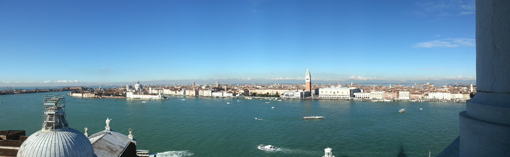

The night train was not as comfortable as my own bed and I woke up every other hour, still it was way better than those 8 hour transatlantic flights that always give me a neck pain, when I sleep.

Whatever marginal discomfort the train ride might have left me with, it was totally blown away by the great first day in Venice. Here's a photo that I took today: It shows Venice as seen from the bell tower on the island of [San Giorgio Maggiore](http://en.wikipedia.org/wiki/San_Giorgio_Maggiore).

Lots of sun, great places to visit, great art, not too many tourists (at least compared to Venice in summer). What can I say: A Perfect Day in Venice.
