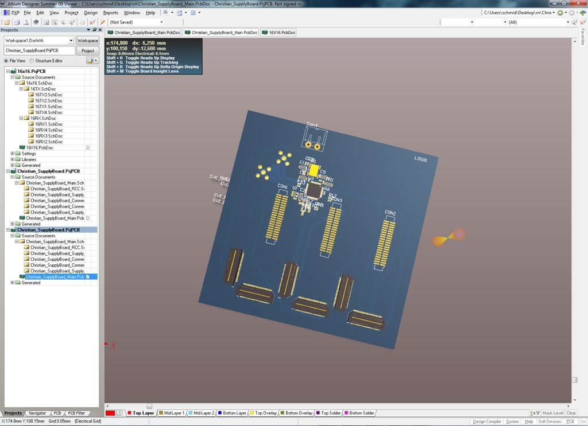

Designing and building stuff that exploits physics to serve a specific function, that's what I think it comes down when you ask me about what engineering is.

Today I took this screenshot that is almost like a stereotype for what we electrical engineers do. Actually this PCB (short for printed circuit board) was not even designed by me. It was designed by a gifted colleague who did it according to my specifications.

It's the power supply for my newest 77-GHz radar front-end, which would be the really interesting part. Sadly I can't show you the radar, because if I would I'd not be able to publish it in any scientific journal or conference. Something like this [http://ieeexplore.ieee.org/xpl/articleDetails.jsp?tp=&arnumber=6507334](http://ieeexplore.ieee.org/xpl/articleDetails.jsp?tp=&arnumber=6507334) or [http://ieeexplore.ieee.org/xpl/articleDetails.jsp?tp=&arnumber=6697594](http://ieeexplore.ieee.org/xpl/articleDetails.jsp?tp=&arnumber=6697594). And publications is what the scientific engineering community also lives for.
