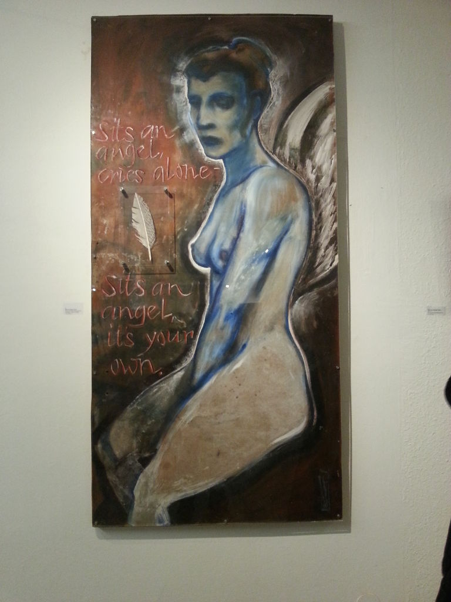

Another night out playing some jazz music. This time for the visitors of the vernissage of Austrian artist Jörg Wascher.

The gig was ok although for me listening to Jazz while looking at art (mostly paintings, but also some sculptures) and drinking wine is a little bit too much of a cliché. Plus I don't like background music in grocery stores, so why would anyone like it at a vernissage?

But it's not my call, we got paid for the gig and I really enjoyed playing with that group. We were four and we have not played in that setup before, but interestingly all share some kind of common history or are linked otherwise.

The trumpet player, Erwin, and I are friends for a long time. He also studied mechatronics, and obtained his PhD a couple of years ago. After being a post doc at KU Leuven he's now back at JKU for another post doc position. His office is on the same floor as my office.

The bass player, David, was the youngest of our group, about age 20. He studies bass at Anton Bruckner university, the school where I studied jazz piano for some time. And here it comes: We also were neighbors for most parts of our lives! Our parents are still neighbors. David has an older brother Joe (we're almost the same age), who is a brilliant guitar player. It really is interesting that neither my personal, nor Joe's or David's musical paths crossed while we still lived in Thalheim. - I played in a band with Joe later and with David for the very first time tonight, but not before anyone of us was older than 20.

The drummer, Markus, played in Joe's band while we were teenagers, and I would see him every now and then from across the street. Also he was one of the best friends of a very good friend of mine, who I met much later - they went to the same music highschool. So I have met Markus again at a couple of birthday parties since then. - He went on to become a professional drummer.

It is funny to see how all of us are connected to other people in such diverse ways, how we develop our own paths. And sometime, like magic, they cross again, or lead into different directions ...
