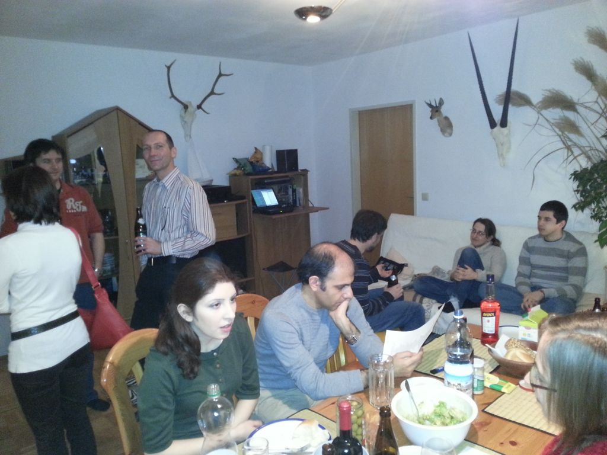

Four years ago, when our research group moved to the new Science Park building we used to go out or grab an after-work beer regularly. We let go of this tradition somewhere along the way. Last week we even found out that the beer in our refrigerator is well past its best-before-date (which some Austrians consider a serious offense).

I did really appreciate it when Herbert (this time it's not a fake name, but he also works at Infineon) invited us to join him for a nice evening with drinks and sausages.

Some comments on the photo: His last name is Jäger, which is the German word for hunter and he really is a hunter. The trophies are from some of his hunting trips. Another curiosity: You can't see it but he's still using Winamp, that's so 90s ;)
