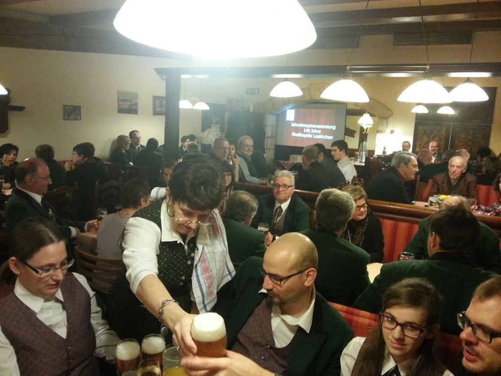

Some suggestions what you can do to live up to the stereotypes about Upper Austria/Bavaria:

1.  Play a brass instrument
2.  Be a member of a local wind band
3.  Go to church
4.  Go to a Gasthaus (tavern, inn) after you've been to church

I guess I can say I payed my dues today. 1/2 are things that I am doing for years and 3/4 were part of today's general assembly of the Stadtkapelle Laakirchen (a local wind band), which I took part in. During the 3 hours event we were informed by the ExCom of the registered association about the past year, future plans, the financial situation, ...

Lots of talking, lots of fun, lots of beer (not for me actually as I was the designated driver), lots of photos from past events, lots of awards (especially for members of age 60+) and a great evening for all of us.
