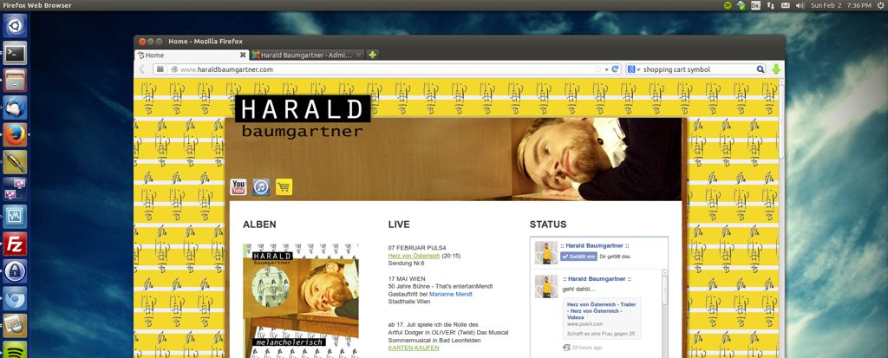

About two years ago I blogged about [setting up the website of Austrian singer Harald Baumgartner](/blog/the-making-of-haraldbaumgartner-com/ "The Making of Haraldbaumgartner.com"). In an attempt to make his work more well known to the public he's now part of a reality television-music competition series called "[Herz von Österreich](http://www.puls4.com/herz-von-oesterreich)" ("Heart of Austria"). It's only airing in Austria, so you might not have heard of it, it's similar to the [Idols](http://en.wikipedia.org/wiki/Idols_%28TV_series%29) TV series. - As I don't watch television, I didn't know about it either until he called me last week.

The show in which he's going to appear is going to air this week on Friday and so some updates to his website became inevitable. I guess that's the kind of stuff you're supposed to do on an idle Sunday afternoon. Helping an old friend.

See for yourself [http://www.haraldbaumgartner.com](http://www.haraldbaumgartner.com) - and please don't forget to vote for him on Friday.
