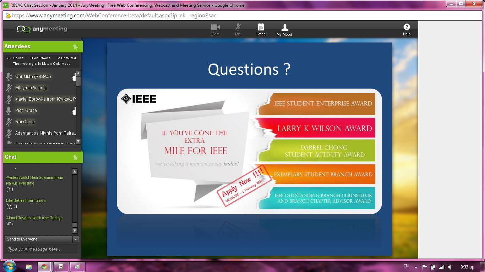

We had the very first IEEE Region 8 SAC online chat session this year. About 40-50 participants from all over Region 8 (Africa, Europe, Middle East, Russia) dialed in. We (Piotr, Femia, Maciej, Rui Costa) tried to give them an update on

-   the upcoming [awards nomination deadline](https://www.ieee.org/membership_services/membership/students/awards/student_branch_awards.html)
-   the awesome [IEEE Academic program](http://academic.ieee.org/)
-   and the [2014 IEEE Region 8 Student and Young Professional Congress in Krakow](http://sypkrakow.pl/).

I guess there are a lot of exciting things coming up in 2014. Some people started sharing screenshots from the online session on facebook. I can't resist to share with you the screenshot of this pink desktop by Christine Avdikou.

