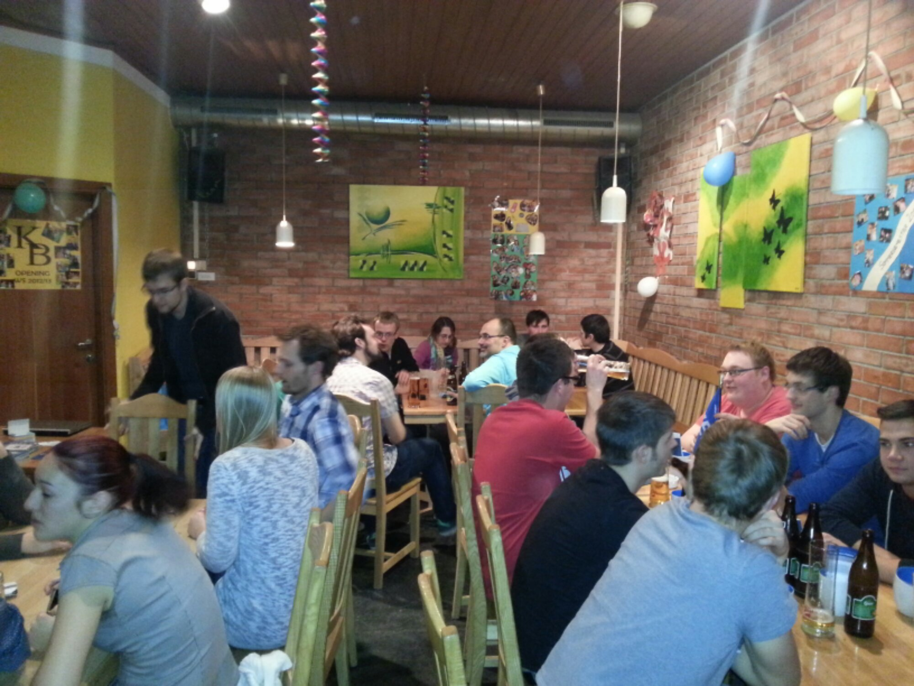

While my job as [IEEE Region 8 Student Representative](/blog/i-am-ieee-region-8-student-representative/ "I am IEEE (Region 8 Student Representative)") involves working two and sometimes three levels higher up in the IEEE geographic hierarchy, I always enjoy staying in touch with the [local student branch (SB) at JKU](http://ieee.jku.at/). After all that's the entity where my IEEE track started.

Being past past past chair is one thing, but what is really rewarding and makes me happy is to see that the SB is even more active than in my days and that they prosper like never before. Apart from many other activities they still have their monthly series of Stammtische, which are social meetings that try to bring students and industry closer together.

That is exactly where I spent today's evening: The IEEE Stammtisch featuring [Commend](http://www.commend.at).

This is how it works: The SB approaches companies that might be interested in giving a presentation. A company representative joins one of those meetings in a local bar and pays for drinks, food and some extra cash for the SB. In return the SB provides the infrastructure (beamer, ...) and the students.

What's in it for the company? To get in touch with potential future employees or customers. What's in it for the students? To get in touch with potential future employers and to learn about what's happening outside the academic world.

What's in it for me apart from that? Grabbing a beer with friends, getting to know the future leaders of the SB and learning about what matters to the current generation of engineering students.

