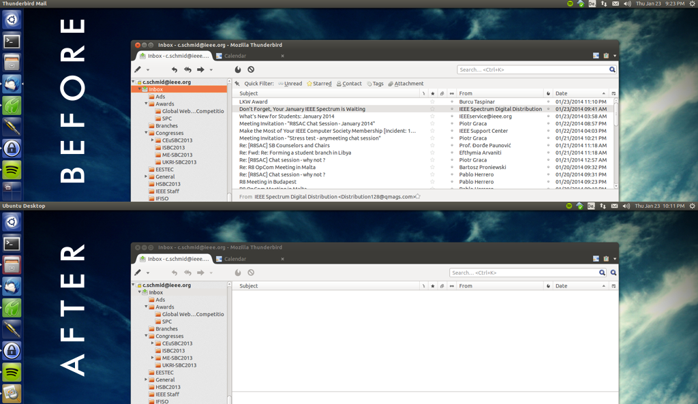

I did some statistics [a while ago](/blog/ieee-4-months-later/ "IEEE – 4 months later"). Today I can give you an updated version. My term as IEEE Region 8 Student Representative lasts for 388 days now and on average I have received about 18 e-mails per day and I have sent out about 3.5 e-mails per day. - My work and private e-mails go through different accounts, so that is just the IEEE stuff.

The way I try to deal with my mail is simple. - Nothing is allowed to stay in my e-mail Inbox, unless it is unfinished buissness. If I receive some invitiation to some conference that I don't care about -> it goes into my Ads folder. If I receive some ads -> again Ads folder.

Other mail goes into project related folders unless it requires some action that I am for some reason not willing to put on my todo list. In that sense my Inbox is also a kind of todo list, which should be as empty as possible. From time to time I fall a little behind, so it was time to do some serious housekeeping today.

