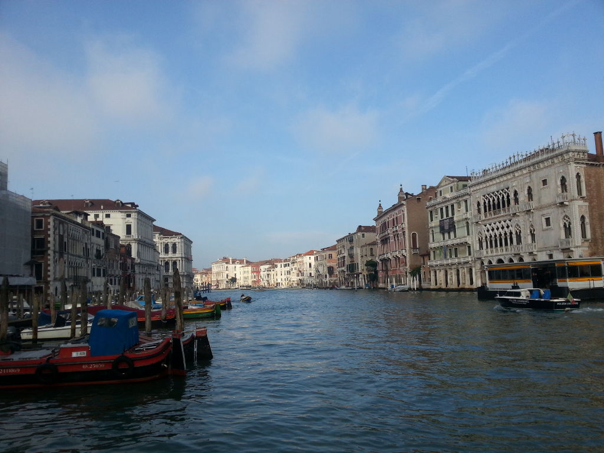

The last day in Venice is over and I am on the train again on the way back home. I had a great time and lots of great memories to take home with me!

A visit to the Peggy Guggenheim collection was on the list for today. While I am not sure about Peggy (she's buried on the grounds of her collection right next to her 14 dogs), I am sure that I saw some great pieces of art today including some Picassos.

Some final walks without any specific destination but the goal to breath in some of the cities air concluded this short visit. I am sure I'll be back some day!

