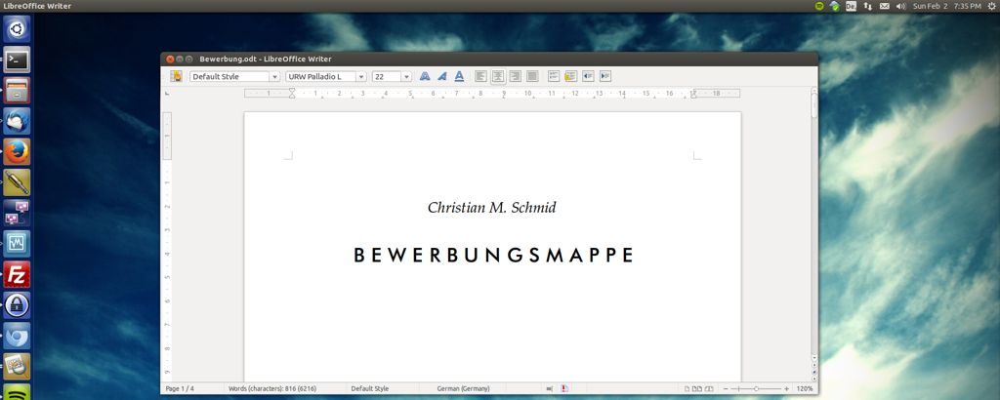

In [my last post](/blog/looking-for-a-job/ "Looking for a Job") I claimed that part of my research is paid for by [Infineon](http://en.wikipedia.org/wiki/Infineon_Technologies), the rest of the money is actually coming from public funding. That is why we have to provide an annual report about our activities once a year. Today I spent most of my time preparing the 2013 report.

The afternoon mostly went into updating my CV and preparing job application material. This week's discussions made me understand that I should at least be able to hand in something at any given time. - You gotta be prepared ;)

