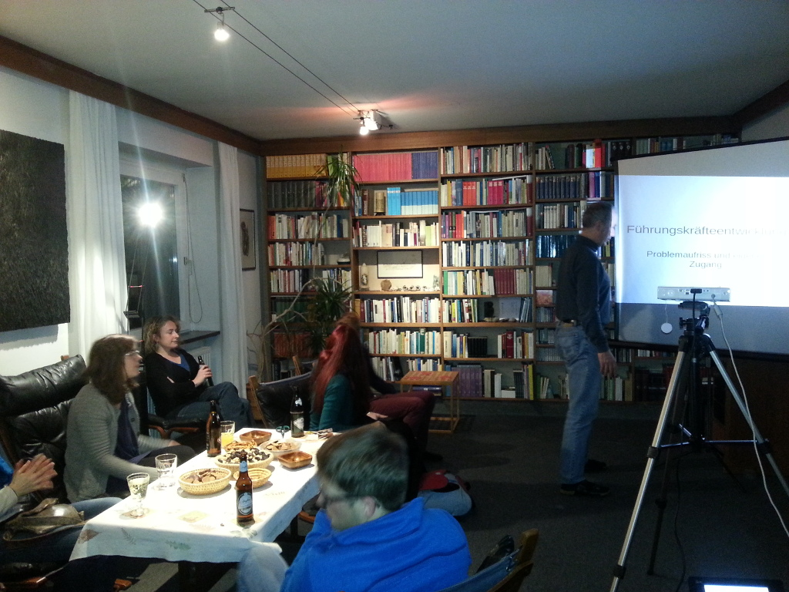

I am part of a network and scholarship program called "Pro Scientia".

One of the aspects of "Pro Scienta" is that the scholarship students meet once or twice a month. During those meetings one of the students presents his research, art or any other topic that has some scientific, religious, cultural, historical, social and whatnot relevance, which is then open for discussion.

All of the scholarship students are grad students and mostly PhDs. Today we had a presentation from [Benjamin](http://www.jku.at/ipp/content/e171900/e172664/index_html?team_view=section&emp=e172664/employee_groups_wiss172701/employees172748), a PhD student in the field of education and psychology, about "Development and learning of leadership skills with a special focus on principals". Well the actual title was a little shorter, but that's just my interpretation.

The discussions are often intense, they are totally worth it. I've never found myself having discussions in such an interdisciplinary setup before joining Pro Scientia. In the photo you've got a lawyer, an engineer, a priest, an architect, a social scientist, an artist.

So if you are a grad student or artist who happens to be in Austria, are interested in interdisciplinary discussions and are good at what you do, you might want to consider applying for a Pro Scientia Scholarship: [http://www.proscientia.at/](http://www.proscientia.at/).
