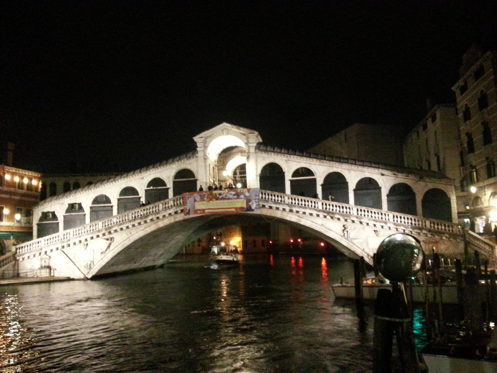

... the weather was not as good as on the first day, but good enough to allow for a visit to the Doge's Palace and the island of Murano,

Murano is known for its long tradition in the production and manufacturing of glass. I don't exactly know how much of the stuff you get there today is Chinese, but I guess the island still adds to the charm of the Venice.

We enjoyed dinner at a restaurant that had a beautiful view on the [Rialto bridge](en.wikipedia.org/wiki/Rialto_Bridge).

They even had WiFi, so I could publish [Harald Baumgartner's Website](/blog/harald-baumgarter-herz-von-osterreich/ "Harald Baumgarter @ Herz von Österreich") after his show had aired directly from that Rialto bridge restaurant. Oh how I love technology ...
