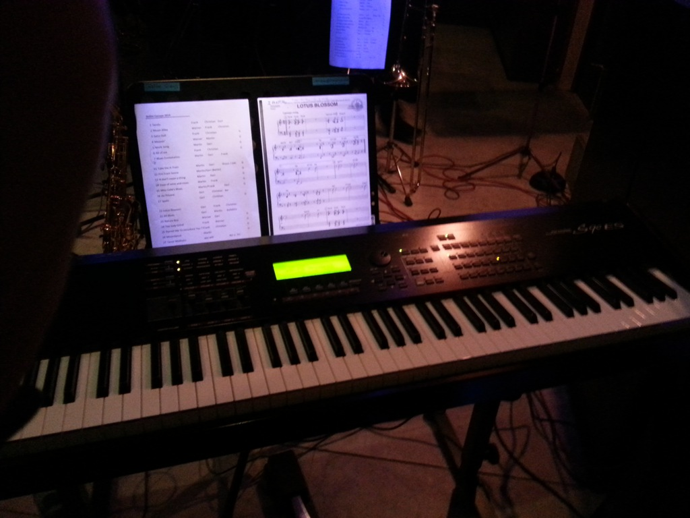

... I was a musician. The time when I practice the piano for hours every day and the time I played at least a gig every week. Today I am an engineer with a profound understanding of music but with a lack is practice. Maybe that's a good thing. Because there's no pressure, no need to make a living out of music.

Today I had one of those once-or-twice-a-month gigs that I still do with a band called [Bojazzl](http://bojazzl.prambachkirchen.net/) at [a small bar](http://www.canape.at/), about an hour from Linz. Their piano player had broken his clavicle and they had asked me to jump in, which I really enjoyed. Although I would have needed more rehearsals to really make the most out of it.

