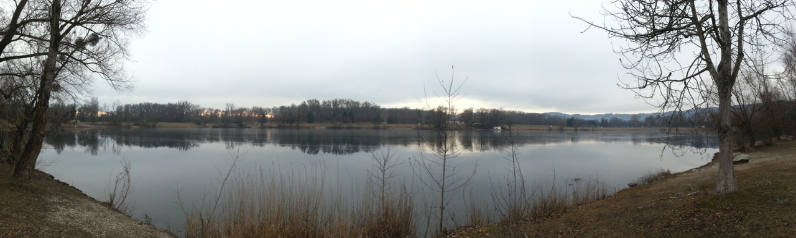

Today was an idle day. Some playing portal, some cleaning, relaxing and going for walks. It's way to warm around here, so it feel a little like walking in April.

Later that night we had a teleconference for the next IEEE Region 8 Student and Young Professional Congress in Krakow, Poland - the event formally known as IEEE Region 8 Student Branch Congress (SBC). The meeting was dedicated to online promotion of the event.

I think in the end it was a good meeting, although I do feel that we are making progress too slowly. But we have still enough time left, so I'll promise you it will be the best SYP congress ever!
