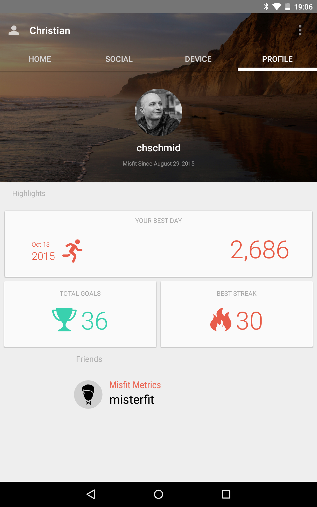

[Another 30 day-project](/blog/try-something-new-for-30-days/): I bought a new gadget while I was in the US 4 weeks ago, a Misfit Flash activity tracker. The idea: It costs only 30 USD and if it would motivate me to stay active for 30 days in a row, this would mean a cost of 1 USD per day. In other words way less than your average gym membership. And I did it - I achieved my activity goal for 30 days in a row.

Misfit measures activities in points and I set my target to 1200 points (roughly 12000 steps) per day. While achieving this goal was never physically demanding, I had to schedule additional walks regularly. Especially on days with no other workouts (I run and swim about 1-3 times a week), and on days that were filled with meetings or travel.

I think I'll move back to using Polar Flow as my primary activity tracker, because in addition to activity in general it can also track running, swimming, cycling, hiking and more using GPS and heart rate sensors. However the idea of tracking my activity and trying to avoid days without activity should stick.
