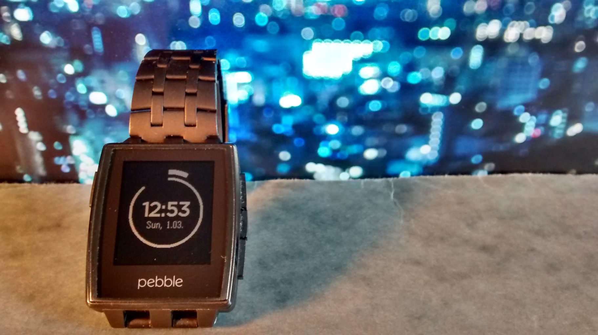

I own a Pebble Steel for quite some time now, and I still love it. Good battery life and not too many, but useful features. It was a no-brainer that I joined their latest record-breaking [kickstarter campaign for the new Pebble time](https://www.kickstarter.com/projects/597507018/pebble-time-awesome-smartwatch-no-compromises) as an early bird.

At the same time I had to do something that I do with almost any piece of hardware that I own and that lets me do it: Write some code for it! Sometimes it's just the mandatory [hello world](http://en.wikipedia.org/wiki/%22Hello,_world!%22_program), but this time it's a watchface for the Pebble:

I was amazed by how little time it took me to write (or should I say copy and paste) the code. I've uploaded the watchface to the [Pebble app store](https://apps.getpebble.com/applications/54fb92804720a88f330000a6) so that it can be installed by everybody who owns a Pebble and the [source code can be found on github](https://github.com/chms/ArcS). Please let me know what you think of it and keep the hacker spirit high by writing code for every piece of hardware that you own!
