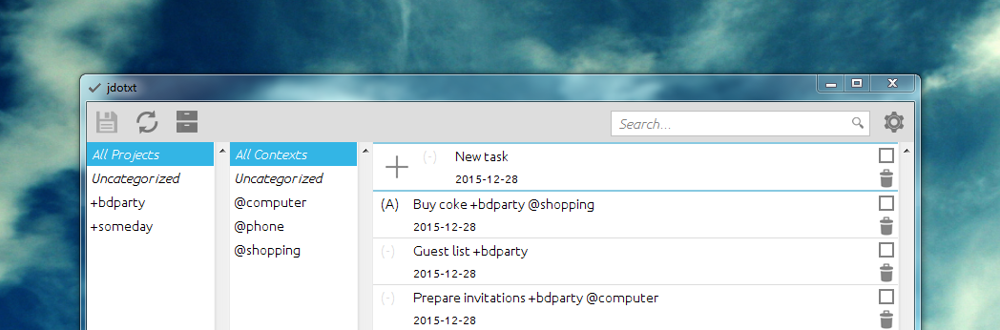

jdotxt is an open source, cross-platform Desktop tool for managing your todo list. It's geared towards [Gina Trapani's todo.txt](http://todotxt.com/) file format and stores all of your stuff in two human readable text files. Having these files on your owncloud, dropbox or any other cloud storage makes it easy as pie to keep your todos in sync across multiple devices.



## Download and Installation

-   ### Windows (Installer)
    
    [Download installer](http://dl.bintray.com/chschmid/generic/jdotxt-0.4.8-win.exe). When you launch jdotxt, you may be asked to download and install Java, which you should do in that case.
-   ### Mac OS X
    
    1.  Make sure you have Java JRE >= 7 installed. E.g., by downloading and installing it from [http://www.java.com](http://www.java.com)
    2.  As always: [download, mount, drag&drop this file](http://dl.bintray.com/chschmid/osx/jdotxt_0.4.8.dmg)
-   ### Ubuntu >= 12.10 (Repository)
    
    Open a terminal and execute the following three commands (line by line):
    
    ```
    sudo add-apt-repository ppa:chms/jdotxt
    sudo apt-get update
    sudo apt-get install jdotxt
    ```

    
-   ### Ubuntu 12.04 LTS
    
    First you must get JRE >= 7 by executing the following two commands (line by line):
    
    ```
    sudo apt-get install openjdk-7-jre
    sudo update-alternatives --config java
    ```

    
    After executing the second line you will be asked, which version of Java you would like to use by default. Select the one that has version number 7 or higher in its path name.
    
    Now continue with the instructions for Ubuntu >= 12.10 (see above)
-   ### Debian GNU/Linux
    
    Download and install the [jdotxt Debian](http://dl.bintray.com/chschmid/deb/jdotxt_0.4.8_all.deb) file. Of course this works on Ubuntu too, but it is highly recommended to use the repository, for automatic updates.
-   ### Generic (Works on Windows, GNU/Linux and Mac OS X)
    
    [Download the jar file](http://dl.bintray.com/chschmid/generic/jdotxt-0.4.8.jar "jdotxt") and execute it using Java JRE >= 7 (http://www.java.com)

## Mastering jdotxt in 110 Seconds

<div class="video"><a class="yt-embed" href="https://www.youtube.com/watch?v=Wz9Xnvb71t4" data-youtube="Wz9Xnvb71t4" title="jdotxt - an open source, cross-platform todo.txt desktop client"><span class="yt-play"></span></a></div>

## Get Involved!

You are more than welcome to drop me a line via one of [the online platforms I use](https://blog.chschmid.com/?page_id=942 "Online"), or to contribute by reporting bug reports or feature requests [via github](https://github.com/chms/jdotxt/issues). The source code is also hosted on [github.com](https://github.com/chms/jdotxt) so feel free to contribute!

## Contributors

Christian M. Schmid Mikhail Kalkov

## License

jdotxt is free software: you can redistribute it and/or modify it under the terms of the GNU General Public License as published by the Free Software Foundation, either version 3 of the License, or (at your option) any later version.

This program is distributed in the hope that it will be useful, but WITHOUT ANY WARRANTY; without even the implied warranty of MERCHANTABILITY or FITNESS FOR A PARTICULAR PURPOSE. See the GNU General Public License for more details.

You should have received a copy of the GNU General Public License along with this program. If not, see [http://www.gnu.org/licenses/](http://www.gnu.org/licenses/).
