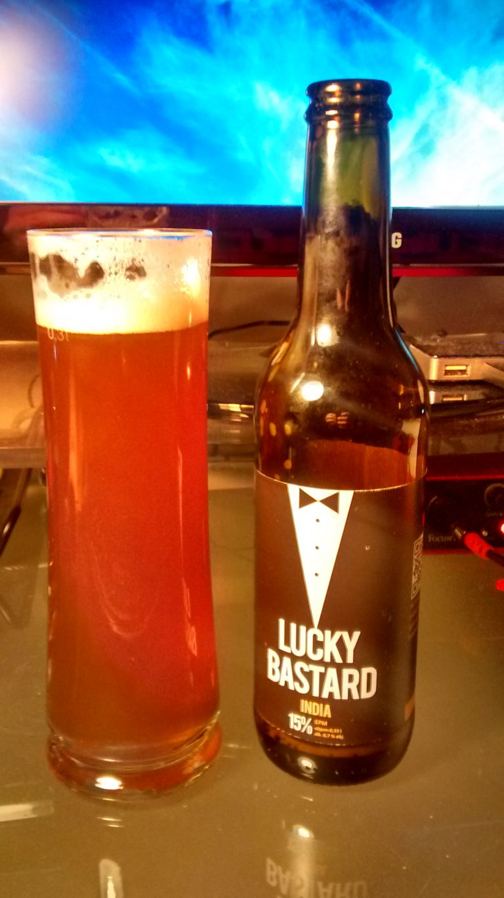

[Another 30 day-project](/blog/try-something-new-for-30-days/ "Try Something New for 30 Days"): I don't drink any alcohol for 30 days. For me alcohol = beer. I don't usually drink anything other than beer. But beer, I drink a lot. Not as in large quantities at a time, but being Austrian a beer here and there just seems natural. Once you are conscious about it, you realize how many opportunities there are for that one beer.

I am into this project for 16 days now. Honestly I would not have felt comfortable letting everybody know about it on day one - chances were I would not be able to stick to my plan. But now I am certain that it will work.

If that makes me sound like an addict on detox, it's not what I wanted to suggest. It's just that during the first week my resolution was tested 5 out of 7 days: You know, friends and colleagues asking about an after work beer. The obligatory beer after the jazz gig. The waiter at that Italian restaurant asking me if I would fancy a Peroni. "No" became an important word. Some people around me keep teasing be, but it only makes me stronger now, because it reminds me about my decision of not drinking beer for 30 days.
