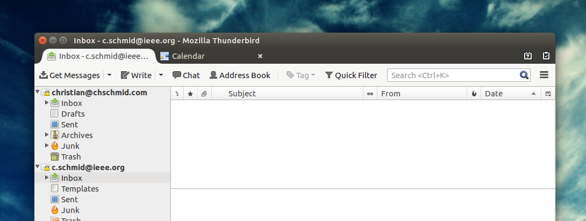

This is an apology to all the people who have sent me an e-mail over the course of the past 5 months and have not received the response they expected in time. I was swamped at work, with my PhD project, IEEE activities and other challenges in my private life. But now I am on top of things again. I've reached "Inbox Zero".

  
With it comes the "Mind like Water" state and I am now ready again for your e-mails. Let's see how long it lasts ;)
