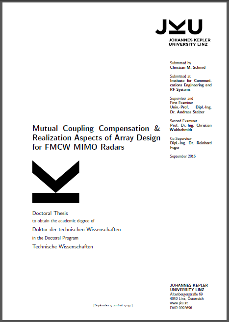

The road to my PhD is a bumpy one. But finally I think I am at the point where it becomes realistic for me to close this nasty open loop within the next 3 months.

The first step (that I am willing to blog about) was the informal submission of my thesis today. I submitted it both to my supervisor and the second, external examiner from the University of Ulm.

We may want to think about shopping for champagne. I'll keep you posted.
