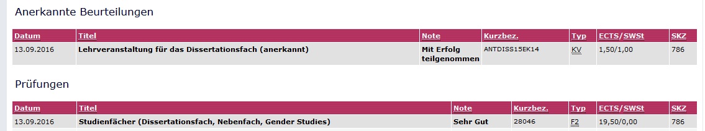

Finally I figured out which curriculum applies - they have changed it 5 times since I've started my PhD. Lucky as I am, the classes and ECTS that I have collected so far can still be used today. Some bureaucratic hurdles later, the university online system now says that I have completed all my ECTS duties. Yay!

We may now actually buy the champagne. I'll keep you posted.
