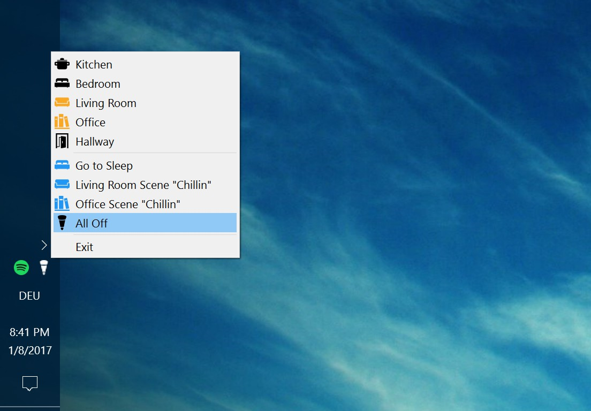

Every year around Christmas I start a little DIY project, that most of the time involves some programming and some real hardware (e.g., [TI chronos: My watch controls my bedroom lights](https://blog.chschmid.com/?page_id=193 "Ti chronos")). With most light bulbs in my apartment being Philips Hue light bulbs, I decided I wanted to be able to control them from my PC. So this Christmas I created "Hue System Tray", a tiny program that lives in the system tray and lets me check the status of my hue lights as well as control them.

Instead of using Java, which I've used for most of my GUI programs (e.g., [jdotxt](/blog/jdotxt/)), I did this little project in C++ using [Qt](https://en.wikipedia.org/wiki/Qt_%28software%29). The only down-side is that Philips does not offer a C++ SDK. To keep things simple I decided not to implement a full-blown SDK myself. At this point in time the program basically makes hard-coded RESTful API calls to the Hue bridge directly. It would of course be much nicer if the list of rooms would be populated automatically from the list of rooms stored on the bridge and if all API calls were derived automatically. But hey, holiday time is limited ;)

This was my first encounter with Qt and a rather pleasant one I have to say. The signals and slots mechanism is rather intuitive, it features a nice collection of libraries (e.g., for networking or for parsing JSON), the documentation is good and the learning curve is not too steep. Actually I found programming Java for Android apps more difficult. Also deploying my program to another machine was not too difficult, once I had figured out which dlls to carry over.

I will probably have to do some more C++ coding at work in the near future, so I hope that dusting off my C++ skills and Qt will come in handy.
