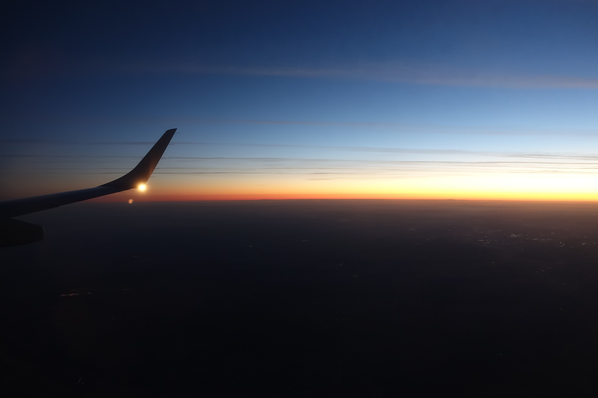

When I look outside the window, I see the sun setting. It is setting faster than usual. That's because it's the window of an airplane and we are flying east.

This morning, before getting to the airport, I was woken up by the sound of my phone's alarm. I turned it off and went ahead with bad habit: I checked the news. The headline: "Limiting temperature increase to 1.5 °C unrealistic, is global worming unstoppable?"

There you go, my dilemma in two short episodes. I am surrounded by information about global warming and still I rock an off-the-charts-carbon-footprint lifestyle. Travel is just so much fun and too affordable. Plus my job requires me to go places. Actually most of my carbon footprint comes from work related travel. Would quieting my job be the right thing to do? Wouldn't just somebody else take my position and do the same traveling instead? Should I stop going on vacation too-far-away at all? What's too far? Is there a way to compensate for what I am doing to our planet? When I'll look back at this dilemma in a couple of years, will I hate myself for not being more decisive on the issue? Will it still be there, or will we have found ways to deal with it? Will regulators have come up with smart solutions?

And most importantly: Chicken or Pasta? Uh, dinner is about to be served. What a welcome distraction, let's just postpone dealing with the issue.

*Airplane Sunset*
