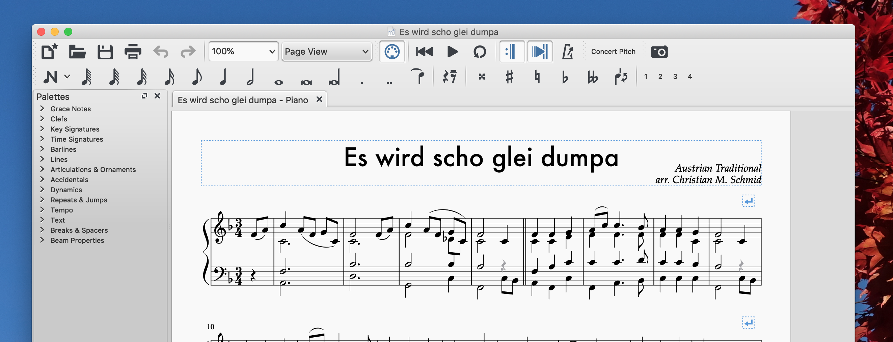

Download brass quartet sheet music: [Es wird scho glei dumpa](/files/2018/12/Es-wird-scho-glei-dumpa.zip).

Please note that "Es Wird Scho Glei Dumpa" is also part of the compilation [Christmas Reharmonized, Volume 1 & 2](/blog/christmas-reharmonized-volume-1-2/).

Here's what it sounds like when played on a piano:

<audio controls="" src="/files/2018/12/Piano-Es-wird-scho-glei-dumpa-Take-2019.mp3"></audio>

### The Story Behind

I like Christmas. Especially the couple of weeks before Christmas eve. It's getting dark and cold, but there's candles and everything is lit in vibrant colors, we cuddle, drink tea and sing our favorite Christmas carols. At the some time everybody is busy shopping or trying to finish whatever they need to get done before the year ends, but we usually still find time to spend with friends and family. It's a confusing but beautiful time. I tried to capture this weird feeling of enchantment mixed with numbing haste by arranging and reharmonizing the Austrian Christmas carol "Es wird scho glei dumpa" for brass quartet.

Word of advice if you want to play it with your band: The second half of the piece could be callenging and needs practicing.

  
This work is licensed under a [Creative Commons Attribution 4.0 International License](https://creativecommons.org/licenses/by/4.0/).
