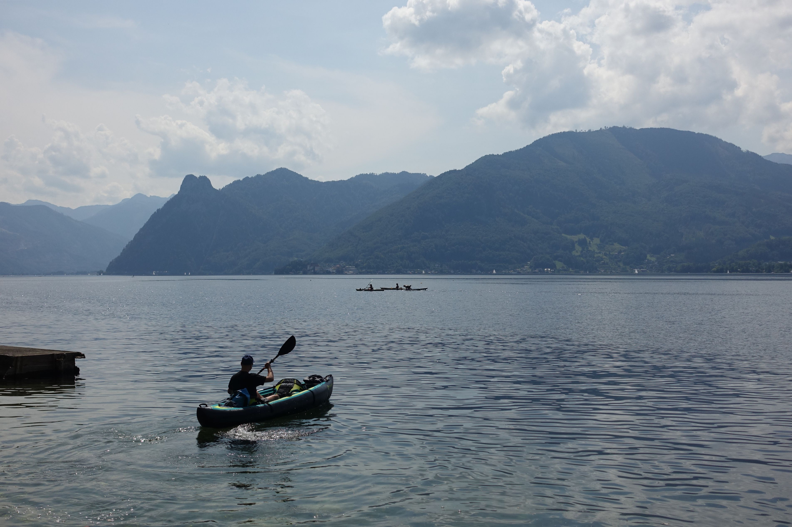
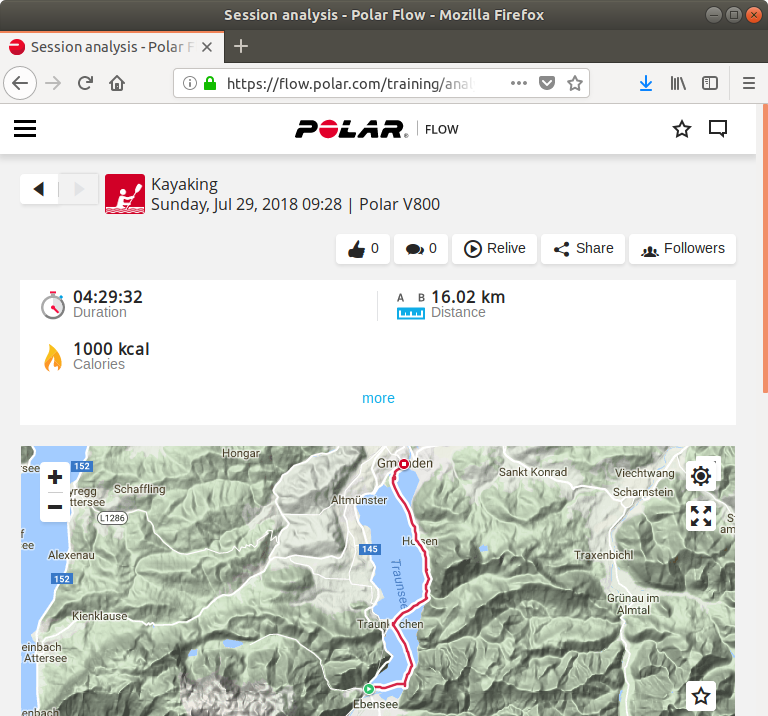

We just traveled Canada for three weeks and there's one thing that became clear to me: I need a Kayak! The whole concept of hiking on water resonates with me on so many levels.

Getting from A to B at a steady pace while enjoying beautiful landscapes is pure pleasure to me. Kayaking has all of that, plus it lets me experience lakes and rivers in an almost meditative fashion. My favorite book is [Adventures of Huckleberry Finn](https://en.wikipedia.org/wiki/Adventures_of_Huckleberry_Finn) and I think that my fascination with water plays a role in that.

Last weekend we did a day-long Kayaking trip from Ebensee to Gmunden. Makes you feel like Huck for a day ...

