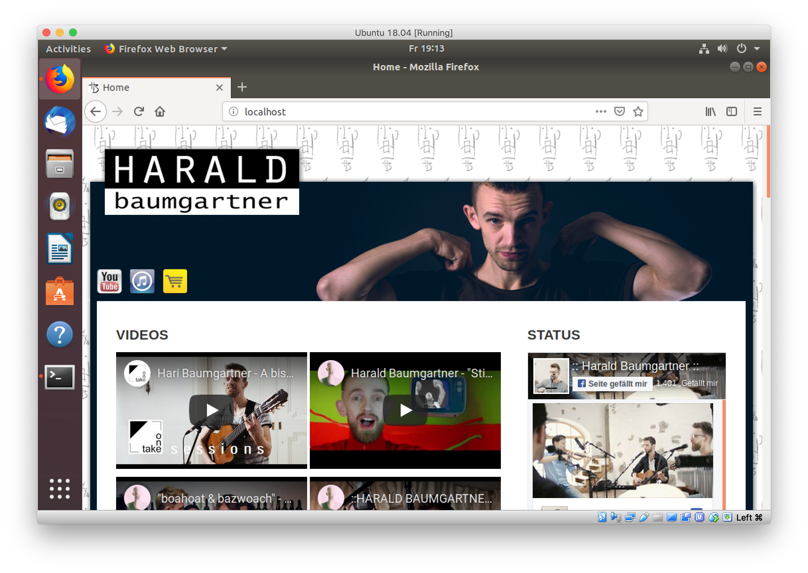

A couple of years back I did a website for a friend of mine, which I blogged about in [The Making of Haraldbaumgartner.com](/blog/the-making-of-haraldbaumgartner-com/). We did a couple of updates since then, but there haven't been any changes over the past three years or so. Moreover I neglected updating the software behind the website, so it was still running off Joomla version 1.7.

About a week ago the provider disabled PHP 5.6, which Joomla 1.7 depended on, so the website was broken. It also meant that there was no path for automated upgrades any more.

After some brainstorming I had found my solution: I decided to recreate the setup that the provider had disabled (Apache, PHP5.6, mysql) in [VirtualBox](https://www.virtualbox.org/). All I had to do is to

1.  Download an [Ubuntu](https://www.ubuntu.com/) 18.04 iso
2.  Install Ubuntu in [VirtualBox](https://www.virtualbox.org/) and then in Ubuntu install Apache and mysql.
3.  Add some PHP 5.6 repository and [install PHP 5.6](https://tecadmin.net/install-php5-on-ubuntu/)
4.  Copy the mysql database over to my VirtualBox Ubuntu Server as well as all the files via FTP

Tada, the website was up and running again on my local machine:

With this in place I could restore all the stuff I nedded and migrate to Joomla 3.9. Finally [http://www.haraldbaumgartner.com/](http://www.haraldbaumgartner.com/) is back online! On the way there I also fixed all the file permissions, so that in the future Joomla would be able to update automatically.
