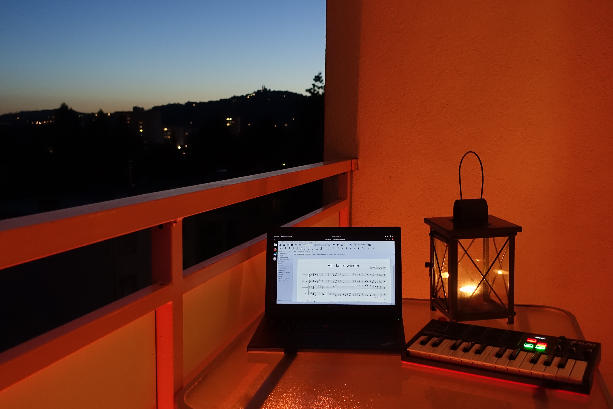

Download brass quartet sheet music: [Alle Jahre Wieder](/files/2019/10/Alle_Jahre_Wieder.zip).

Please note that "Alle Jahre Wieder" is also part of the compilation [Christmas Reharmonized, Volume 1 & 2](/blog/christmas-reharmonized-volume-1-2/).

Here’s what it sounds like when played on a piano:

<audio controls="" src="/files/2019/10/Piano-Alle-Jahre-wieder.mp3"></audio>

### The Story Behind

In 2018 I did an arrangement of the Austrian Christmas Carol [Es wird scho glei dumpa](/blog/es-wird-scho-glei-dumpa-merry-christmas-from-austria/). Preparing arrangements and reharmonizations of Christmas tunes really gets me into the Christmas mood. Actually, it's done best with the smell of candles and the taste of cinnamon tea around you.

However, in order to have something played during the Christmas season (December), you have to prepare the arrangement way in advance. - Bands need some practice ahead of time. Basically, you have to start right after Halloween.

In order to combine both the Christmas season and the special mood I get by arranging tunes, I did "Alle Jahre Wieder" in December 2018. I did not want to share it yet with a broad audience, but we already played it at my local church on Christmas Eve of 2018. And here it is, with enough time to practice, for all of you!

The finishing touch to the arrangement I did on my balcony.

