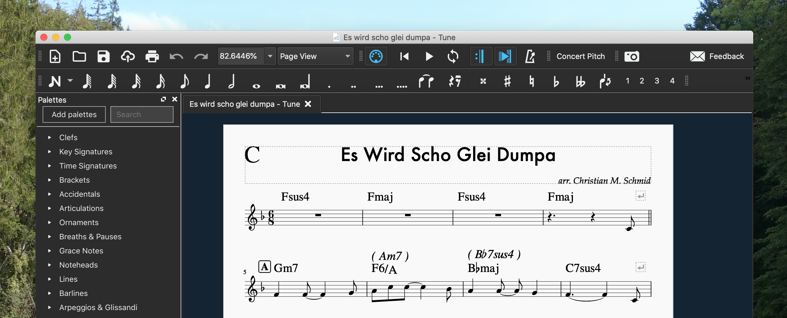

This Thursday there was a [Jazz Jam Session](https://www.facebook.com/events/456657531633776/) very close to where I live. I got home from work at around 7:30 pm. I had a choice of stressing myself, showering and going there right away or taking some time and skipping part of the opening concert. I did the latter and decided to use the time to do a quick lead sheet for the Austrian Christmas Carol "Es wird scho glei dumpa". I had done a [reharmonization of the tune](/blog/es-wird-scho-glei-dumpa-merry-christmas-from-austria/) earlier, but in order to be able to allow for solos it was necessary to write a lead sheet.

I still was able to hear 2 pieces of the opening band, and later we had quite some fun playing and improvising over my AABA lead sheet version of "Es wird scho glei dumpa".

[Here's the complete download](/files/2018/12/Es-wird-scho-glei-dumpa.zip) including the musescore files of both the reharmonization, the lead sheet, pdfs and much more.

