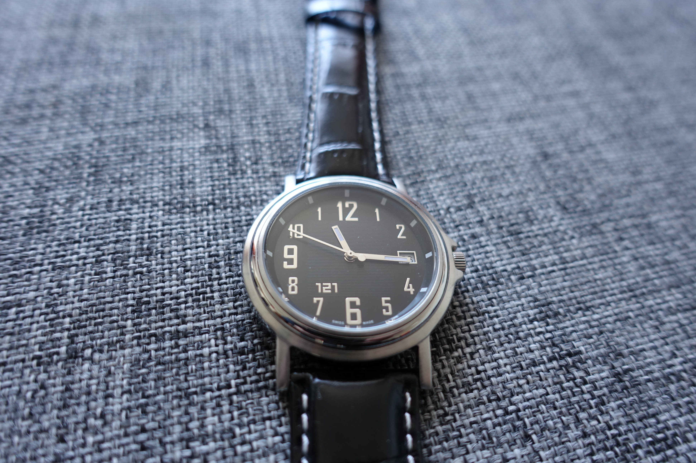
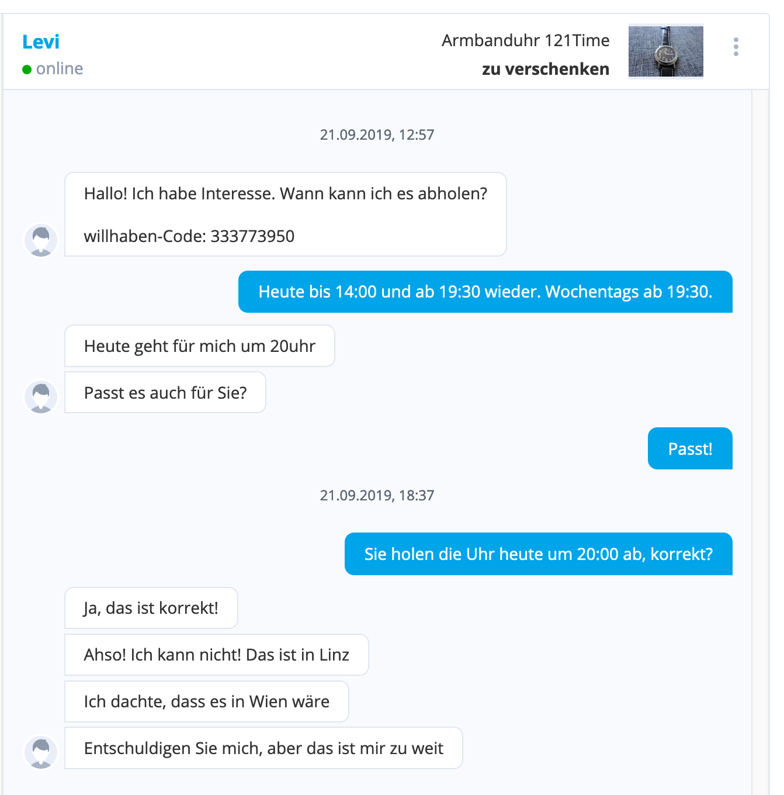

In my quest to declutter, I have identified a pile of stuff that I want to sell or give away. One of the items is a wristwatch in mint condition. It was part of a "best paper award" that I had gotten in 2012. I didn't like the style, so it sat around, unboxed, in some drawer all those years.

The watch itself is nothing special: The online asking price is 132 EUR right now. I thought: Let's try something new and give it away for free. So I listed it on an Austrian website for selling used goods as a "for free item". What happened next is beyond my imagination.

1.) I got over 30 messages in the first 24 hours  
2.) I tried to deal with them on a first-come-first-serve basis.  
3.) Four (4!) attempts to hand over my watch have failed since then.

The first guy who I was in contact with, and who had agreed to pick it up at 8 pm, only told me at 7 pm, after I tried to reconfirm the pick-up, that he lives in Vienna and it's too far for him to come. - Keep in mind the platform clearly tells you where an item is: Address, google maps, everything.

The second person just did not show up, no response.

The third person did not respond when I tried to arrange time and date for a pick-up for 48 hours (the platform reported my messages as "read").

The fourth person finally asked me to bring the watch to a specific location.

I am blown away by how much effort, how much time I spent on this endeavor! I have a feeling that as soon as something is "for free" people perceive it as "has no value". Especially online it's easy to hit the "I want it" button on things that are 0 EUR. But then, when these people have to actually do something to get that "worthless" piece, they are not prepared to do their part. Lesson learned: If you want to explore the abyss of human nature try giving something away for free online. Otherwise don't do it.

Here's how the story ended: I agreed to send the watch to one of the many people who had contacted me. I paid for the postage (5 EUR) and asked him to do something good for someone in his neighborhood. I think that way I sparked a little niceness in the world and did not have to spend any more of my precious time dealing with people who did not value a 0 EUR item.
