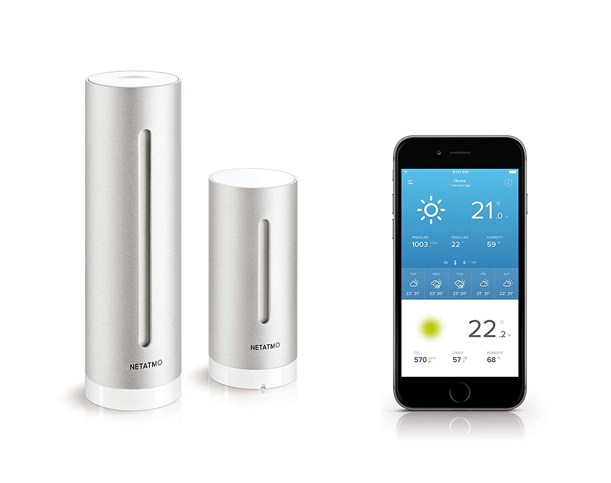
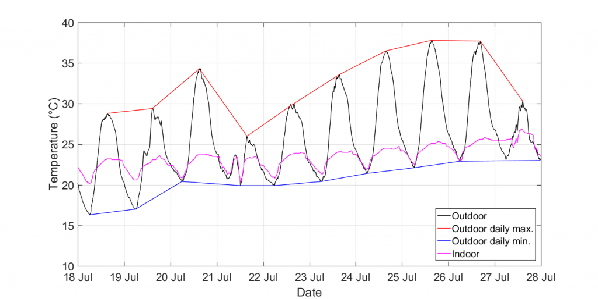

Global warming is a thing. There's no denying that temperatures are rising.

In my quest to learn to live with it, I got a Netatmo weather station that measures outside and inside temperature levels (among other things) in 5 minutes intervals.

My goal is to keep the temperature in my apartment as low as possible without installing AC, so my primary questions are:

-   When to open the windows in the evening, to let in cool air?
-   When to close the windows again?

While the Netatmo website provides a coarse overview of the temperature levels, it's not particularly helpful in answering these questions because ...

1.  the weekly view shows data points in steps of 3 hours
2.  data from different sensors can not be merged into one graph to understand dependencies (e.g., outdoor vs. indoor temperature).

Here's a plot I generated by exporting the raw data from Netatmo and some MATLAB coding.

With all the data available in MATLAB I can now go ahead with extracting some critical data points, such as when the outside temperature reaches its minimum or when it starts increasing again. More on that later.
