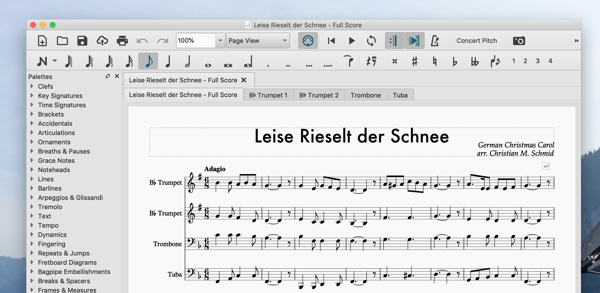

Download brass quartet sheet music: [Leise Rieselt der Schnee](/files/2019/10/LeiseRieselt.zip).

Please note that "Leise Rieselt der Schnee" is also part of the compilation [Christmas Reharmonized, Volume 1 & 2](/blog/christmas-reharmonized-volume-1-2/).

Here's what it sounds like when played on a piano:

<audio controls="" src="/files/2019/10/Leise-Rieselt-der-Schnee-Take-2.mp3"></audio>

### The Story Behind

Oops, I did it again. Did a reharmonization of another local Christmas carol - actually a German tune: "Leise Rieselt der Schnee" - "Snow is falling Softly"

I tried to stay true to the formula that I had used on some other Christmas tunes (e.g., [Alle Jahre Wieder](/blog/alle-jahre-wieder-merry-christmas/)):

1.  First a plain, no-bells-no-whistles version of the song.
2.  Followed by a [drop-2](https://en.wikipedia.org/wiki/Voicing_\(music\)#Drop_voicings) version, that is still not too fancy but already sets the mood.
3.  Third version: That's where I do whatever I feel like: Harmonically, but also, slight modifications of the melody allowed. For "Leise Rieselt der Schnee" I went with a little more rhythm and less harmonic complications.
4.  A reprise of the original tune.

