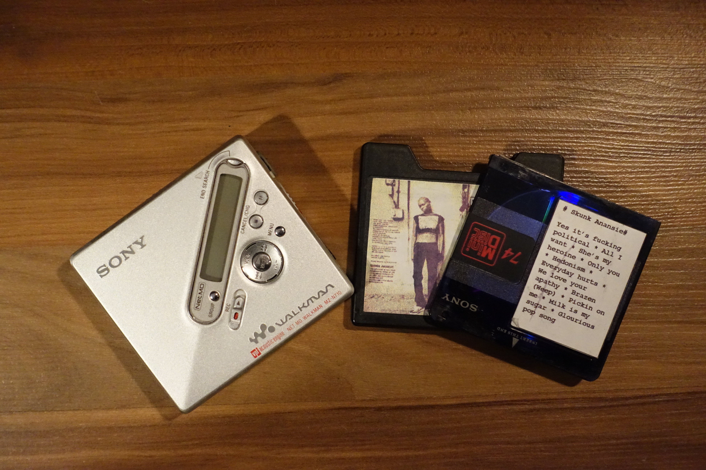

From time to time I need to do some decluttering. I guess everybody does. Usually, it's easy for me to decide between the things that I won't need anymore and the ones that I want to keep. I know myself to be both fast and rigorous about these decisions.

Today I stumbled across a box that broke my flow: my old MiniDisc collection and a Minidisc player. I know that all the money invested in the technology is lost (2 portable units, 1 Minidisc deck, one car stereo that had Minidisc, tons of Minidiscs, ...) and I also know that I won't use it any time soon, neither for recording nor for listening. Still, I seem unable to part with it.

It's not even the Minidisc player that powered most of my teen years - that was a Sony MZ R50 and later a Sony MZ R90, which in terms of esthetics I only loved half as much as the R50. The discs, however, are the "originals". I used to print labels for all of them with images that I scanned from the original CD. Most of them are blurry by now, as I only had an inkjet printer. I am humbled by how much time I must have spent on my Minidisc collection.

I guess I am going to allow myself to keep the Minidisc box around for another while and thus postpone the decision to throw it out. Yep, that's living on the edge.
