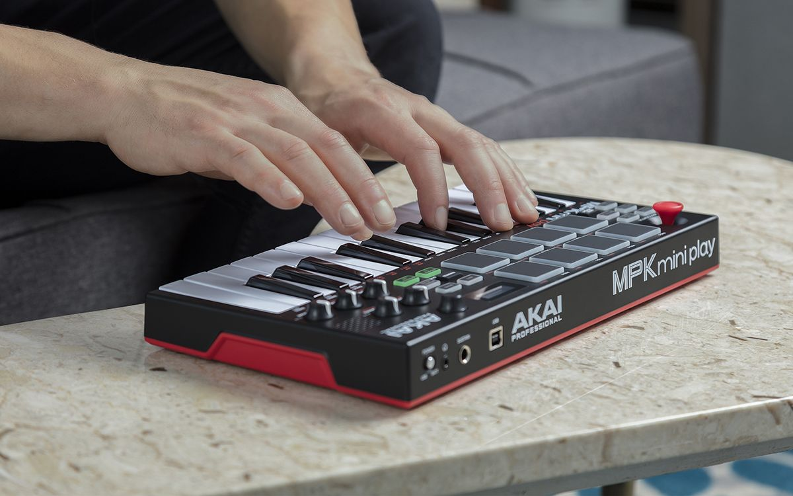

Work at Infineon requires me to go places. As a product architect I need to interact both with customers all around the globe and development teams at five different sites across Austria and Germany. To be able to tend to my inner music nerd while on the road, I got myself a small music keyboard with 128 sounds that fits into my backpack.

Here's a version of "My Funny Valentine" that I did on that keyboard while on the train to Villach yesterday night. I call it "My Funny Trainride".

<audio controls="" src="/files/2019/03/My-Funny-Trainride.mp3"></audio>
