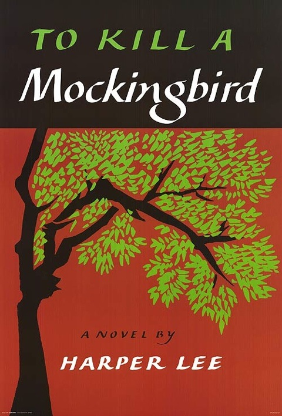

I don't usually do book reviews, but this one got me thinking: [To Kill a Mockingbird](https://en.wikipedia.org/wiki/To_Kill_a_Mockingbird).

I really enjoyed reading the book. On the emotional side I guess it's the admiration that I developed for the narrator - already during the first few pages. On the intellectual side it's the moral challenges the book threw at me.

### About Racism

Let's start with the most obvious. The book deals with racial injustice in the US around 1930.

Now, I was raised in a society of racial indifference. And I mean this in the most positive way: I DO NOT CARE ABOUT RACE. To the point where I may not even notice if you are black or white, Muslim or Christian. I do not have any feelings attached to the classification of ethnic background. Interestingly, in practice, to some this is alienating and to some this is liberating. Alienating to those who want me to honor some societal code associated with race: For instance you can't play the race card with me, because I don't care. Liberating to those who deliver results and who I'll support or promote without hesitation.

Taking this into account, the initial situation described in the book feels just wrong. It's the state of the society in the 1930s, as some critics have claimed, that black people are depicted as too one dimensional in the book, and so much more. The situation described is wrong on all imaginable levels.

To quote from the book: "There's just one kind of folks. Folks."

### About Feminism

I instantly fell in love with Scout, the narrator of the story. If I ever have a daughter I hope I can foster in her some of the qualities found in Scout: Logic, righteousness, self-confidence, eloquence ... I just don't know if it is even fair or realistic to ask for these qualities in an 8-year old.

Let's zoom out: One could argue that gender inequality and racial inequality fall into the same category of problems. Not for me. The difference is that I have personally witnessed gender inequality, while I was, from the very beginning, raised upholding racial equality. Gender inequality is woven far deeper into the fabric of the society that I grew up in. Nevertheless it's wrong, but far more difficult for me to get a subjective grip on.

Enough said. I adore Scout.

### About Moral

Here comes the most challenging aspect. I understand that Atticus Fitch is generally accepted as the moral hero of the story. Two things that he said stick:

-   "Real courage is ... when you're licked before you begin but you begin anyway and you see it through no matter what."
-   "You never really understand a person until you consider things from his point of view…. Until you climb into his skin and walk around in it."

The problem is that, while my stoic self admires these two principles, I still can't resolve them properly within my general system of values.

\--- Attention, spoiler alert ---

See, on the factual side of things the book ends in what can be described as close-to-worst-case scenario: jurisdiction fails, black guy's dead and kids suffer from serious injuries. So what was achieved by upholding these morals?

To reflect on the statement about "real courage":

-   Could it be that by accepting to be licked, both the outcome and the pain in the process to get there become self-fulfilling prophecies?
-   What is the point of suffering if you don't get anything in return. At least one has to gain some sort of satisfaction from the result or the way there (e.g., learning).

To reflect on the statement about "walking in other people's skin":

-   I do get the idea, and in general it can be seen as good advice. Yet again, what is the point, if it does not offer a satisfying way out?
-   What if walking around in other people's skin only shows you that there is no painless solution?
-   How much can and should one tone down their empathy to still get to a desired outcome (i.e., black guy cleared of all charges, real evil behind bars, kids saved)?

As an engineer I tend to focus on the outcome, the "what". The "how" is equally important, especially as most of the big things simply can't be achieved alone. However, I have a hunch that sometimes we need to cross the line, and accept that stoic morals won't get us any further.

The real problem is that the rules and costs of crossing this line are not yet evident to me.
