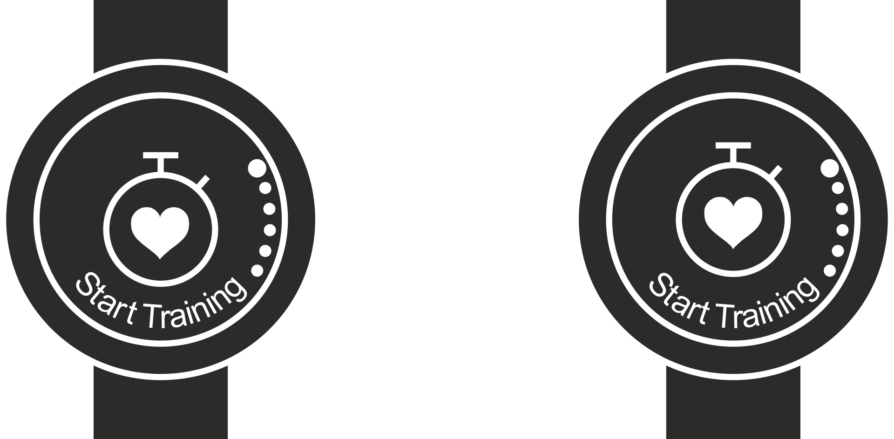
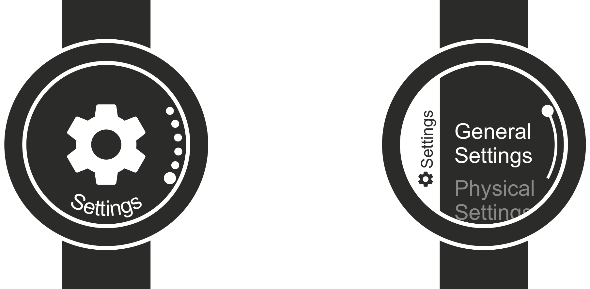

There are many great things I could say about my Polar Vantage M watch. I like

-   it's clean, rounded physical design (as its an early model it does not ever have any ugly logo on the front),
-   the fact that I can use it with different wrist bands,
-   its battery life,
-   and much more.

But there are also a few things that really bother me a lot. Here are the top two things that I think need improvement and that could be improved easily via a software update

## 1) UI Aesthetics

Here's an example that annoys me every day. Have a look at the following two versions of a watch screen.

Look left, look right, look left, look right. Which one feels right, which one feels wrong?

To me its the left one that feels wrong. Sure the icon as a whole, which is a stopwatch with a heart at its center, is centered. However, I think it should be the keyline, the circular outline of the stopwatch, that should be centered instead.

**Polar if you are reading this: Please make the screen I see when I press the "Menu/Back" button look like the right-hand side image! Center keylines and not complete icons.**

## 2) UI Inconsistencies

Here's the most annoying: Cycling through menus workings differently depending on where you are.

-   
    

When I enter the main menu I can press up to get from the first menu item to the last, which is settings. Once inside the settings sub-menu I can not press up to access the last menu item on that list? Also, the way the list of items is indicated is different (dots vs. just one dot and a line)? Why, oh, why???

**Polar if you are reading this: Please let me get to the last entry of every list by scrolling up from the first entry!**

The cherry on top: The sub-menu item I use the most (changing the alarm clock) is at the very bottom of the list. Polar: Have you evaluated how your users use the UI, e.g., which settings they use the most? Do you think people access their "General Settings" or their "Physical Settings" as often as their "Alarm Settings"?

**Polar, I think you are a great company and you can make this one right by just one software update. Thanks!**
