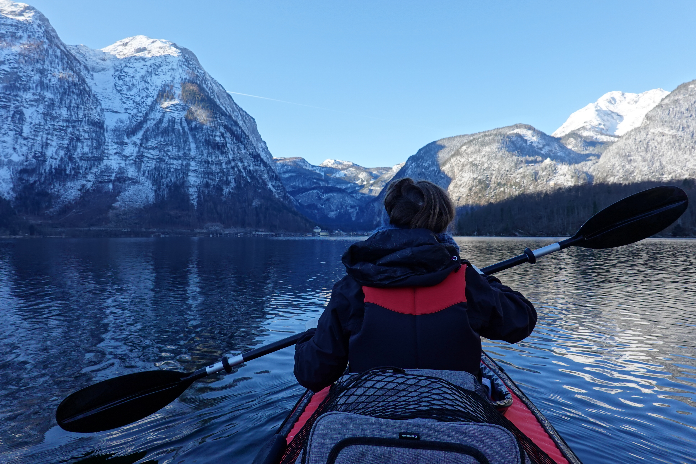

My [winter kayaking tour on the river Danube](/blog/welcome-2020/) was just the start. With the knowledge gained from this trial, Andrea and I went to the next level and did Lake [Hallstatt](https://en.wikipedia.org/wiki/Hallstatt).

A unique experience with another set of lessons learned:

-   Andrea needs a warming belt for her lower back (already ordered).
-   Because of the mountains, there are only about 1.5 hours of sun at lake Hallstatt during winter.
