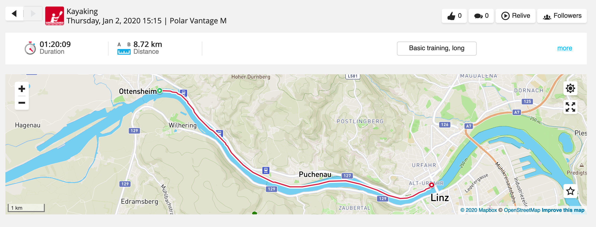
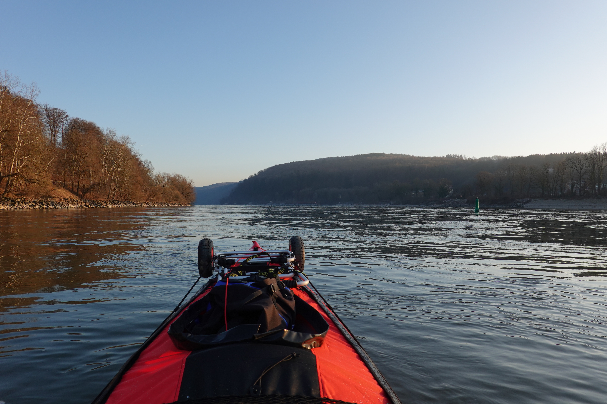

Still Kayaking. What a better day to start kayaking in 2020 than January 2nd. When everybody has sobered up.

Actually, it was just a trial run for more winter tours to come.

Lesson learned:

-   invest in shoes
-   long johns may prove to be comfy
-   no special kayaking jacket needed
-   plan an extra 15 minutes for set-up and wrap-up
    -   mounting the cockpit takes 15 minutes
    -   inflatable kayak becomes very stiff at sub-zero temperatures.

Other than that everything went fine. I think we are now ready for more adventures!
