I do not usually do product reviews, but as I invested significant time and effort, I thought you might find this write-up useful.

My starting point: After resigning from first trombone in our local hobbyist brass band, I had to return the instrument they had loaned me over the past 25 years. A beautiful, gold-plated Willson trombone with a Rotax Valve. Not an easy goodbye.

While I mostly focus on playing the piano these days, I would rate myself as semi-professional on the piano, I still get to play the trombone once a month for small gigs (funerals, church, X-mas events, …). So I needed a trombone. I started with the following requirements:

1.  Use case: Everything, from orchestras to big bands to small groups.
2.  F valve section required
3.  Reasonably priced, i.e., below 3000 € because
    -   my current level of playing does not justify one of those custom instruments
    -   it will be used in all kinds of weird situations where dents ~~might~~ will occur, e.g., small stages where other amateur musicians will hit my instrument with theirs.
4.  Nice tone, good playability (slide, valve) and ergonomics
5.  Last but not least: Build quality that should get me through the next 30 years without foreseeable issues.
<!--more-->
After consulting with two friends, who are professional trombone players, I narrowed down my selection to 4 instruments: 2 refurbished trombones, the Yamaha YSL-548 and the Rath R400. Especially the latter two to me seemed proper competitors. Both are in a similar price range: 2000-2500 €. Both tick off requirements 1-3 from my list above. Both claim to be "step-up instruments", positioned between entry-level and full-custom / professional instruments.

> From Yamaha's Website on the YSL-548: "... eventually a beginning student model horn will start to hold them back. Yamaha offers the perfect line of instruments to keep pace with their burgeoning musical growth…Allegro."

> From Michael Rath's Website on the R400: "For those looking to progress from a beginner’s instrument to their first professional level trombone the R00 series of instruments is excellent in developing style and technique before progressing to a fully customized trombone."

I got both horns, the Yamaha from a [local dealer](https://www.danner.at/) and the Rath from the [Thomann Online Music](https://www.thomann.de/) store. I liked the sound of both instruments. The ergonomics are good on both, with a slight advantage for the R400 because of its thumb rest. The YSL-548 wins the valve competition: smoother action.

But here comes the big one: Boy was I blown away by the differences in build quality when comparing them side by side. In my opinion the Yamaha made the R400 look cheap, rather than a serious competitor. While I am aware that the R400 is actually manufactured in China, Rath also claims:

> "Whatever your needs, the Rath R00 series of trombones offers a unique combination of the highest level of input of design and craftsmanship in trombones with the production qualities that make Michael Rath trombones famous around the world ... So when expert training and quality materials are put together and quality control adhered to, it is irrelevant where the manufacturing location is … The Rath R00 series represents excellent quality, playability and affordability!"

Based on these statements and the photos from the online store my expectations in terms of build quality were high. What I got though, especially with the Yamaha right next to it, did not live up. Let me summarize the Rath build quality in one photo:

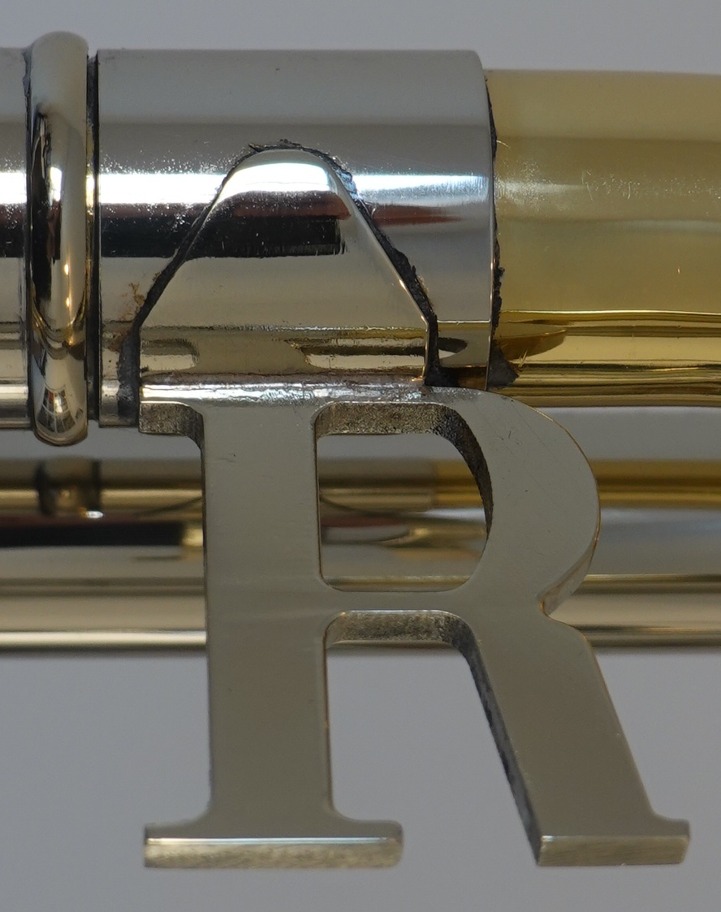

Yes, this is a mint Rath R400. By the way, this was my expectation based on the photos from the Thomann Online store:

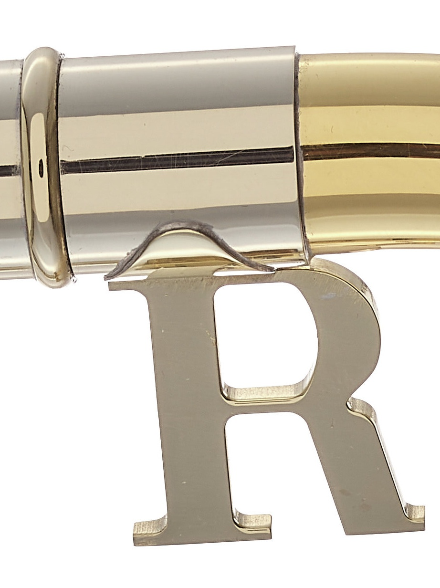

To let you in on the side-by-side experience with the Yamaha YSL-548 here some close-ups of similar parts from both instruments:

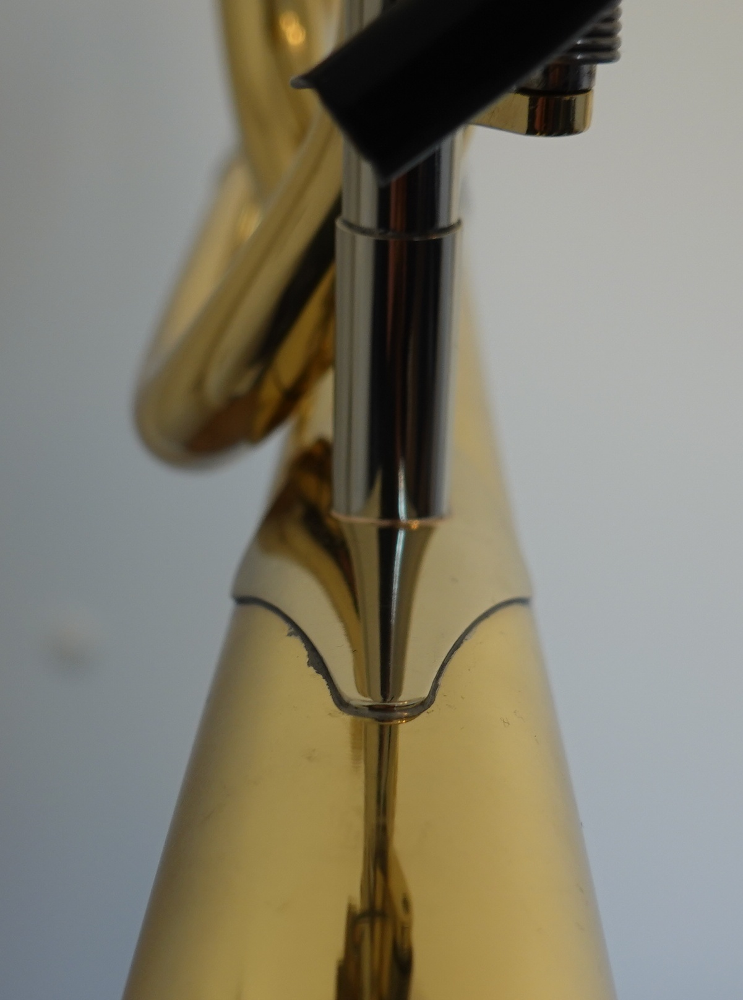 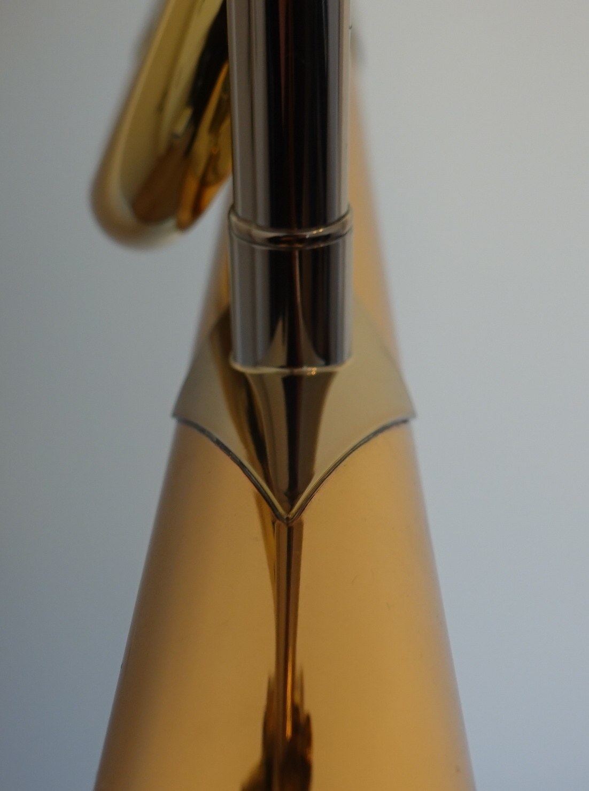

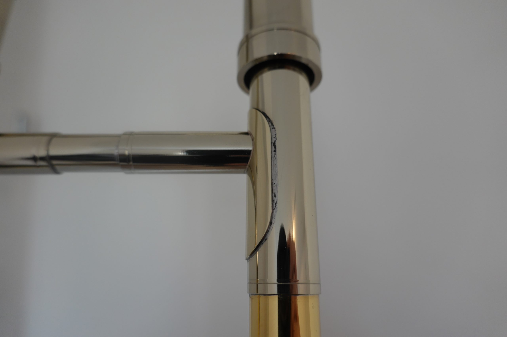
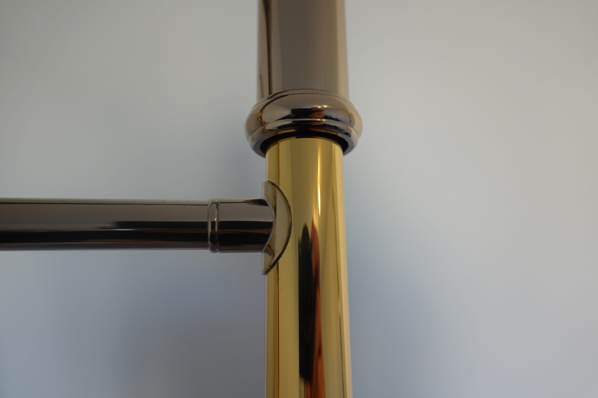

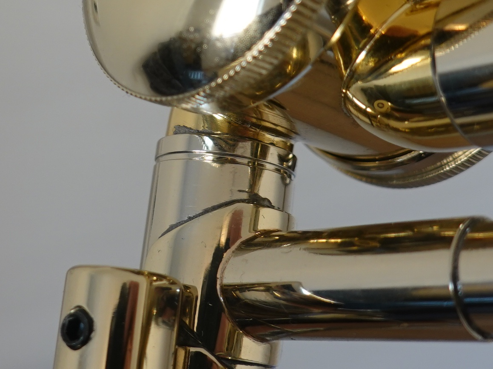
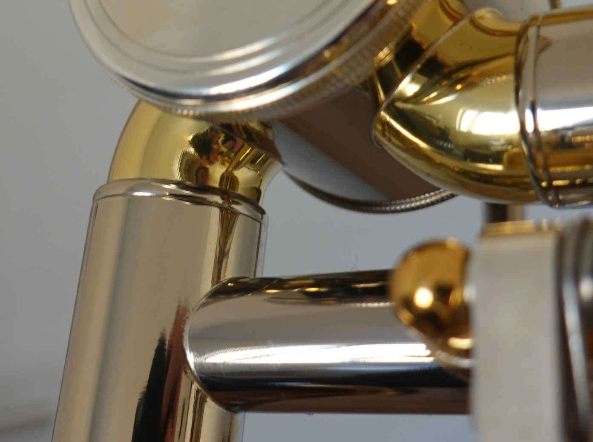

The difference was striking. You may argue: Well it's just cosmetics. But there some spots on the instrument where I am not even sure if there is sufficient solder material going all around the pipe connections. On the R400 there is a visible gap between the outer and inner pipe of some joints.

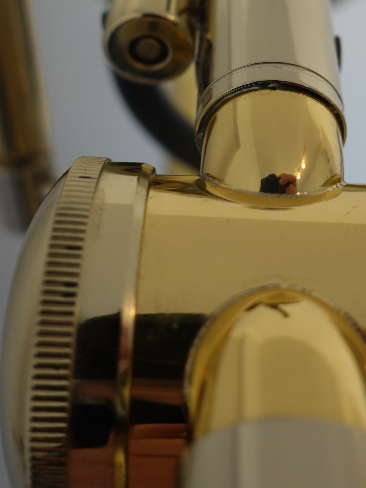
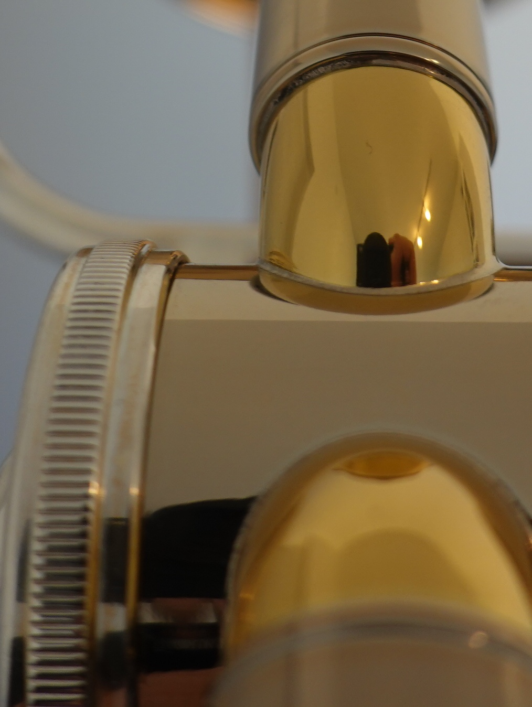

By the way, those black dots on the knurled valve caps on the R400 really are under the lacquer. Which brings me to the next issue: the lacquer, there are at least two spots on the R400 that I had in my hands that looked like this.

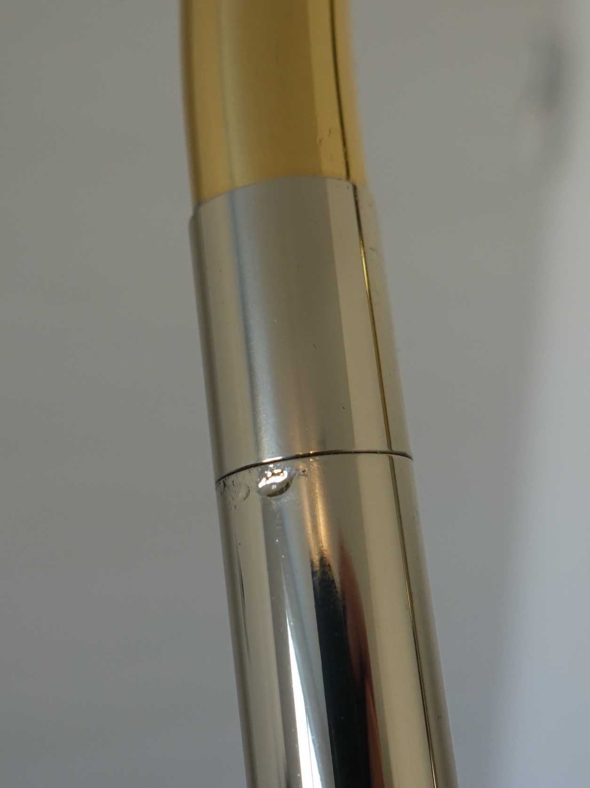

No its not water drops, its lacquer. Perfect execution on the Yamaha. Also the color of the bell is not even on the R400. This was too hard to capture on a photo as you will only see it clearly when you move the instrument and realize that it's not shadows you are looking at but coloration that moves with the bell. It's like the polishing was not done evenly or some oxidation happened before lacquering. The final point I'd like to make is with respect to the design. There is this one spot on the R400 that looks like this - by design:

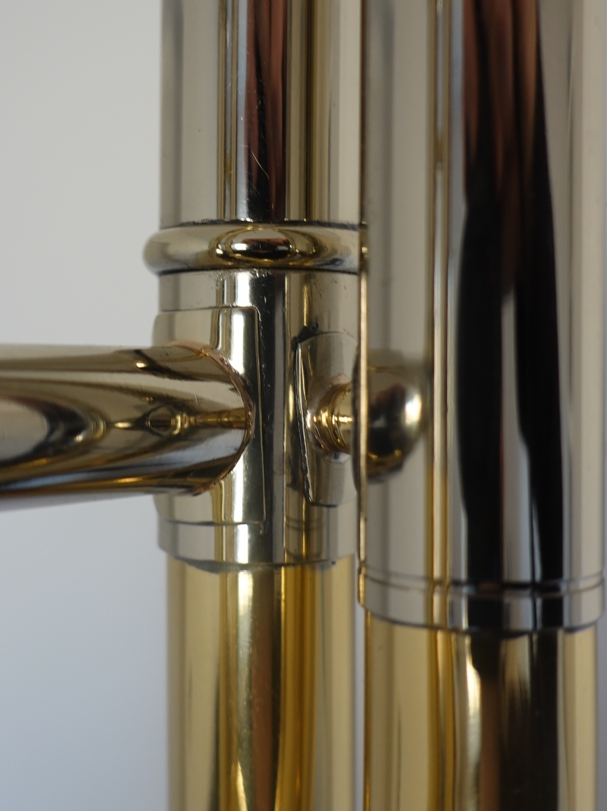

What we see here is two solder joint "landing pads" that both come in a certain shape - the right one is round, the left one has a more involved shape. Both landing areas are so close to each other, that both the rounded pad and the other one had to be cut off manually to allow for them to be soldered. To me this looks somewhat improvised/ugly and I would regard this as a design weakness.

Let me be clear: I am not a trained brass instrument technician. I have no idea as to why many of the solder connections on the R400 are black, huge and ugly and others seem to have come out nicely. I can also not judge on the long term effects these observations, e.g., the drops of lacquer, will have. The only point of reference I have from my professional life as an electronics engineer is PCB soldering. There black solder connections are a sign of poor quality which often leads to issues down the road. It happens when for example the temperature is too high and the flux burns too fast or when wrong materials are used. Experts usually don't produce such results. In any case: As an uninitiated, yet critical customer comparing the R400 to a Yamaha at the same price point and other more expensive competitors, I can't help but feel that there is something off about Rath's statement:

> "So when expert training and quality materials are put together and quality control adhered to, it is irrelevant where the manufacturing location is"

To me it seems more plausible that in terms of build quality the Rath R400 should belong in the same bracket as say certain [Jupiter](https://www.thomann.de/at/jupiter_jp636rl.htm) and [Thomann](https://www.thomann.de/at/thomann_probone_2_gm_bb_f_tenor.htm) instruments. - Which are priced at half or even less of what the Rath R400 costs.

Needless to say, I kept the Yamaha YSL-548 and sent back the R400. Kudos to Thomann. As always, they uphold there promise on customer satisfaction and I could send the instrument back free of charge.

For a brief moment, before I had the Rath R400 in my hands, I thought that I could get out of Yamaha land - I own four Yamaha stage pianos and synths and obviously keep coming back for they have never let me down. I thought: Let's go for a small shop in England rather than the big cooperation. Sorry Yamaha that I was unfaithful. While there are ultra high-end and expensive instruments that outshine your products (think Steinway pianos, custom-built Rath trombones, ...), when it comes to performance and cost, you consistently are a top-tier contender.

Dear reader: You are in the market for good quality at a reasonable price but don't want the hassle of comparing all available options? Don't worry, go for Yamaha.

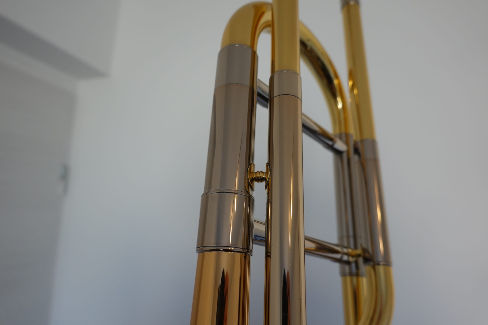
