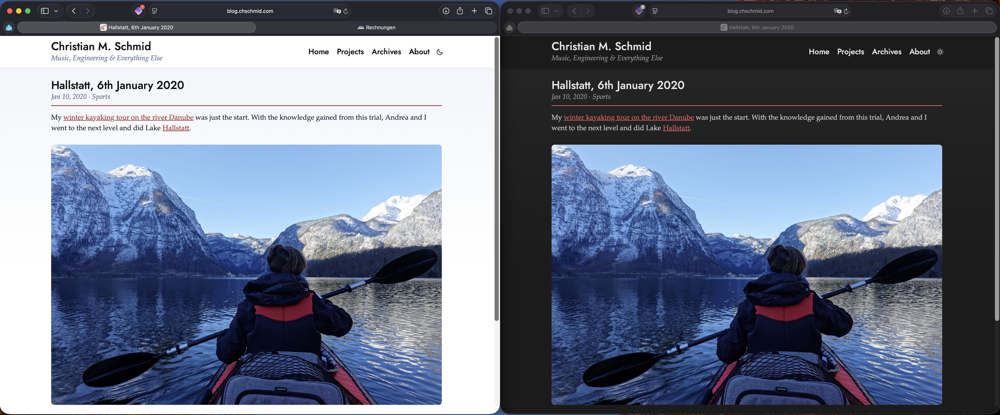

A shiny update for 2026. Minimalistic, beautiful and with light and dark mode. The most important changes are under the hood, though: going from WordPress to a static website. Taking the next step in [my personal www story](/blog/a-personal-www-story/), I can't help but wonder if we are going in circles.

## Why?

My former blog was based on [WordPress](https://en.wikipedia.org/wiki/WordPress), one of the biggest content management systems, written in PHP. It seemed like a good idea when I started the blog, however, today I realize that the maintenance and implications are just a pain in the arse:

- The WordPress code base is huge, and you'd better update regularly to avoid getting hacked.
- If PHP is fucked, we are all fucked, which [just happened](https://en.wikipedia.org/wiki/PHP2Shell).
- Server-side scripting and databases mean some sort of paid provider.

All of this can be avoided by using static web pages, and everything on my previous site except the commenting function is a perfect fit for them. So if you can live without comments, static is the way to go.

Interestingly, static is also how we started the web: first coding just HTML, later using tools like [Microsoft FrontPage](https://en.wikipedia.org/wiki/Microsoft_FrontPage). In the 2010s everything had to become a web app. So yes, we went full circle, now with [Astro](https://astro.build) instead of FrontPage to generate the static files.

## How?

I wanted to keep all the old blog posts and update the design to a leaner design with contemporary typography. At the same time, I moved the domain and the hosting to Cloudflare and introduced a Git-based workflow around Markdown files, with automatic updates of what's online whenever I push to GitHub. If you're curious, the [source code is public](https://github.com/chms/blog).

Sounds like a mammoth project? With Claude Sonnet 5.5 this was about 4 hours of work and 20 USD worth of tokens. Let's be clear: It would have taken me days to figure it all out without the help of AI. More on that later.